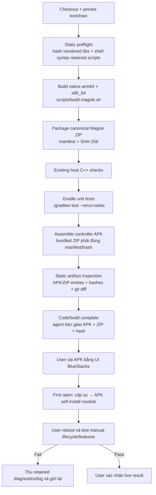

# Phase 8 — Cleanup code, script và chuẩn hóa build → test

Plan: [Tổng quan](00-overview.md)

## Điều kiện bắt đầu

- Phase 1–7 đã hoàn tất ở mức code hoặc giữ capability fail closed với blocker rõ.
- APK đã sở hữu flow self-install module; external host install không còn là
  production/test contract.
- Agent không chạy BlueStacks/E2E. Device flow cuối phase chỉ là handoff để user
  thao tác thủ công.

## Script inventory đích

| Quyết định | Script | Lý do |
|---|---|---|
| Giữ | `build-magisk.sh`, `package-magisk.sh` | Canonical native build/package |
| Giữ | `vendor-pogoenhancer-libs.sh` | Reproduce dependency với pinned blob hash |
| Giữ | `logcat-full.sh`, `collect-binding-diagnostics.sh`, `lib/emulator.sh` | Chỉ dùng khi user test thất bại và cần gửi evidence |
| Xóa | `push-emulator.sh`, `install-magisk-module.sh` | Bị thay bởi APK self-install; dùng chúng sẽ bỏ qua first-open installer cần test |
| Xóa | `device-smoke-test.sh`, `bluestacks-smoke-test.sh`, `binding-probe-test.sh` | E2E/device automation đã ra khỏi scope agent và không thuộc canonical build |
| Xóa | `headless-control.sh` | Consumer duy nhất của loopback HTTP API cũ; UI/overlay là control surface đích |

## Flow build → test mới

## Task

- [ ] **T-805** **[docs]** *(reviewer)* — Lập inventory consumer tại `docs/issues/2026-10-13/pgs-style-zygisk-0433/evidence/cleanup-inventory.md`: với từng script/class candidate ghi direct caller, CI/doc consumer, side effect, replacement và verdict `KEEP`, `DELETE` hoặc `UNRESOLVED`. Historical issue docs không được tính là production consumer; nếu source/CI hiện tại còn caller ngoài bảng trên, giữ file và ghi blocker thay vì xóa mù. **AC:** `AC-16`; mọi deletion có evidence không còn consumer hoặc có replacement đã chốt. **Phụ thuộc:** `T-206`, `T-408`, `T-506`, `T-603`, `T-703`. **Verify:** `rg` toàn repo cho basename/symbol/import; đối chiếu `.github/workflows/ci.yml`, Gradle task graph và maintained docs; inventory liệt kê đủ 12 script hiện còn sau khi reverse script đã bị xóa.

  

  
Chưa thực hiện — T-805

  Chưa có thay đổi hoặc kết quả kiểm chứng. Agent cập nhật khối này ngay sau khi xử lý task, trước khi sang task tiếp theo.

  

- [ ] **T-806** **[scripts]** *(coder/reviewer)* — Xóa sáu entry point đã xác nhận obsolete: `scripts/push-emulator.sh`, `install-magisk-module.sh`, `device-smoke-test.sh`, `bluestacks-smoke-test.sh`, `binding-probe-test.sh`, `headless-control.sh`. Giữ và làm nhất quán `logcat-full.sh`/`collect-binding-diagnostics.sh` với exact target selection từ `scripts/lib/emulator.sh`; cập nhật shell-syntax list trong CI, `AGENTS.md`, README và maintained docs. Không sửa historical issue evidence. **AC:** `AC-16`; không còn host path bypass APK self-install hoặc script tự launch/force-stop game trong canonical workflow; diagnostics thất bại vẫn có target guard. **Phụ thuộc:** `T-805`. **Verify:** `rg` maintained source/docs/CI không còn positive callsite tới sáu script; `bash -n` mọi script còn lại; negative path của retained diagnostic dừng trước thao tác nếu target không đúng/không online; không chạy device.

  

  
Chưa thực hiện — T-806

  Chưa có thay đổi hoặc kết quả kiểm chứng. Agent cập nhật khối này ngay sau khi xử lý task, trước khi sang task tiếp theo.

  

- [ ] **T-807** **[app]** *(android/reviewer)* — Bỏ control surface không còn consumer cùng `headless-control.sh`: xóa `app/.../service/AutomationControlServer.kt`, bỏ `apiServer` start/stop trong `HeadlessAutomationService`, xóa localhost port/API text/import khỏi `MainActivity`, đổi notification/channel copy để mô tả runtime controller thay vì HTTP API và cập nhật maintained docs. Giữ `RuntimeUiAutomationFacade`, service lifecycle, overlay intents, manual arm/config sync và boot behavior cần cho app; không xóa compatibility class chỉ vì test là consumer. **AC:** `AC-15`, `AC-16`; controller không mở port 8765 hoặc có đường HTTP arm/config, UI/overlay vẫn là control surface duy nhất và session mới vẫn OFF. **Phụ thuộc:** `T-806`. **Verify:** `rg` không còn `AutomationControlServer`, `ServerSocket`, `DEFAULT_PORT`, `/v1/start` hoặc `8765` trong production source/maintained docs; focused app compile + existing tests; static review service start/destroy/manual-arm paths.

  

  
Chưa thực hiện — T-807

  Chưa có thay đổi hoặc kết quả kiểm chứng. Agent cập nhật khối này ngay sau khi xử lý task, trước khi sang task tiếp theo.

  

- [ ] **T-808** **[build]** *(build/reviewer)* — Chuẩn hóa `.github/workflows/ci.yml` và local documentation theo flow trên: CI gọi một lần `scripts/build-magisk.sh` thay cho hai block CMake + package lặp, chạy existing host C++ checks, Gradle tests, assemble APK từ đúng ZIP vừa build, rồi inspect entry/hash trước upload. Không tạo script orchestration mới; dùng dependency Gradle ở `T-102` và command canonical hiện có. **AC:** `AC-01`, `AC-12`, `AC-16`; local/CI có cùng thứ tự, không build/package native hai lần và không chạy device/E2E. **Phụ thuộc:** `T-103`, `T-806`, `T-807`. **Verify:** Review job dependency; chạy local equivalent trong đúng thứ tự; ZIP/APK hash/entry check pass; `rg` CI không còn CMake/package duplication hoặc script đã xóa.

  

  
Chưa thực hiện — T-808

  Chưa có thay đổi hoặc kết quả kiểm chứng. Agent cập nhật khối này ngay sau khi xử lý task, trước khi sang task tiếp theo.

  

- [ ] **T-809** **[docs]** *(reviewer)* — Cập nhật `README.md`, `AGENTS.md`, `docs/ARCHITECTURE.md`, `docs/LIVE_AUTOMATION_READINESS.md`, tài liệu build và overview plan để chỉ còn flow build → host test → artifact inspect → user manual BlueStacks test. Ghi rõ retained diagnostic scripts chỉ chạy khi manual test thất bại; không mô tả chúng là E2E gate. **AC:** `AC-12`, `AC-16`; một người mới không gặp hai workflow build/install mâu thuẫn. **Phụ thuộc:** `T-808`. **Verify:** Link/path/command audit; `rg` maintained docs không còn script/API cũ, raw ADB install flow hoặc claim agent chạy BlueStacks; Mermaid khớp CI/task dependency; `git diff --check`.

  

  
Chưa thực hiện — T-809

  Chưa có thay đổi hoặc kết quả kiểm chứng. Agent cập nhật khối này ngay sau khi xử lý task, trước khi sang task tiếp theo.

  

## Điều kiện hoàn tất

- Chỉ còn script có consumer rõ và được phân loại trong inventory.
- Loopback HTTP/headless CLI cũ bị loại bỏ; UI/overlay + runtime bridge là control
  surface duy nhất.
- CI/local dùng cùng một flow, không duplicate native build/package và không có
  device/E2E gate.
- Agent dừng ở artifact inspect; user nhận APK/ZIP/hash và tự test BlueStacks.

Sau mỗi task, agent phải cập nhật checkbox và khối `
` của chính task đó
trước khi chuyển sang task kế tiếp.
